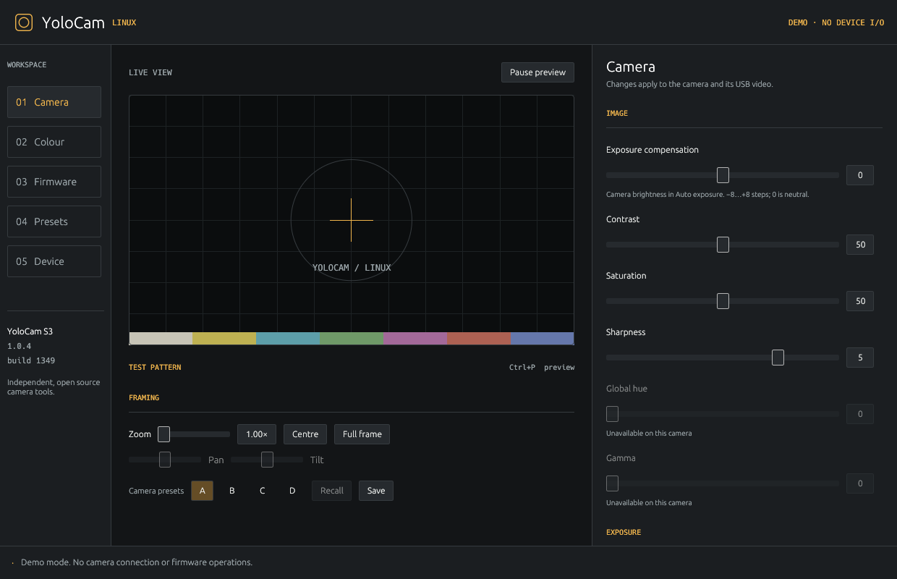

# YoloCam Linux

One native Linux application for **YoloLiv YoloCam S3** camera controls, live
preview, presets and firmware updates. Written in Rust; no Python environment,
Wine or Compose installation is required.

This is an independent community project, derived from Seth Hillbrand's
[YoloCam Linux tools](https://gitlab.com/yolocam-linux/yolocam-linux) and
licensed under **GPL-3.0-or-later**. See [NOTICE](NOTICE) for attribution.



## Install

Download a Linux build from [Releases](https://github.com/rwfresh/yolocam-linux/releases).
The initial binary packages target x86-64 Ubuntu 24.04 or a distribution with
glibc 2.39 or newer; other Linux systems can build from source.

For Debian/Ubuntu, install the `.deb` with your package manager. For the portable
archive, extract it and run `./yolocam-linux`, or install it in your account:

```sh
./packaging/install-local.sh ./yolocam-linux
```

Open **YoloCam Linux** from the application menu, or run `yolocam-linux`.
Connect the camera by USB. The app discovers its USB network address and video
device without changing network settings. `--ip` or `YOLOCAM_IP` can override
the control address when automatic discovery is unavailable.

## Camera controls

The desktop app puts controls beside the live preview and provides pages for
camera settings, colour, firmware, local presets and device information.

- Image controls, auto/manual exposure, shutter and ISO, anti-flicker, white
  balance, focus modes, manual lens position and HDR.
- Native electronic pan/tilt/zoom and four crop presets on newer S3 firmware.
- Hue, saturation and lightness for eight colour ranges, with the HSL switch.
- Installed colour profile/style selection in the active SDR or HDR bank.
- Colour LUT enable/intensity, import of a 5,508-entry packed LUT and reset.
- Optional audio and HDMI controls when the camera reports support.
- Local camera presets and a persistent preview preference.

Readable controls use actual camera readback. The two write-only choices,
face focus region and microphone type, use explicit Apply buttons and show
acknowledgements; their initial state is unknown and failed writes are not replayed.
Rejected or missing capabilities are disabled. Manual exposure, focus and
white balance controls follow their modes.
The app serializes control traffic, coalesces slider drags, sends heartbeats and
recovers broken sockets. Another instance of this app or CLI cannot take over
its control connection.

**Image brightness:** use **Image → Exposure compensation** in Auto exposure.
The slider displays −8…+8 camera steps, with 0 neutral. Click **Unlock exposure**
beside it if exposure is locked; Manual mode uses ISO and shutter instead.
These steps are the camera's compensation scale, not photographic stops.
The legacy 0–100 brightness command does nothing on S3 firmware 1.0.4, so it
is excluded. Existing presets keep their working controls and show an omission
notice for legacy brightness; its old value is never converted to exposure.

**Live preview:** press `Ctrl+P` to start or pause it. Pause the app's preview
before OBS or a video-call app opens the same capture device. Camera controls
continue to work while preview is paused. Video is decoded directly from V4L2
MJPEG buffers in Rust, without an external video process or a local web server.
The built-in preview uses 720p at 30 fps; OBS and video calls negotiate their
own capture format directly with the Linux driver.

## Firmware updater

The firmware page checks the manufacturer's S3 metadata, downloads the official
package, verifies its model/version/build, archive layout, image size limits and
all image checksums, and then offers installation of a **newer** release.
The app shows the package SHA-256, release notes, current version and target.

Downloading and verification do not write firmware. Installation requires a
separate confirmation, releases preview capture, saves a local settings backup,
and shows upload, flash and reboot verification progress. **Keep USB connected
through the update and reboot.** No transfer is automatically repeated after a
lost acknowledgement. Success requires reading the expected version/build from
the rebooted camera.

Only official S3 package URLs are accepted. Packages are cached locally and
are not redistributed with this application. The image checksums provide
corruption checks; the manufacturer's metadata does not supply an independent
publisher signature. Firmware operations use the camera's native USB network
interface and need no Telnet, FTP or root access.

## OBS and Linux drivers

Linux's existing **`uvcvideo`** driver captures video and **`cdc_ncm`** provides
the camera's USB network link. This app adds the native vendor controls and
firmware support in user space; it does not install a replacement kernel module.

Use a normal **Video Capture Device (V4L2)** source in OBS, preferably with the
camera's persistent `/dev/v4l/by-id/…-video-index0` path shown on the device
page. Video calls use the normal webcam entry. The separate vendor controls
do not appear as new V4L2 sliders in GUVCView or cameractrls.

The S3 supports several shared protocol commands only as stored placeholders
or rejects them. Legacy brightness, dehaze, shadows, highlights, global hue/gamma and
unsupported storage/lighting features are not presented as working controls.
See [hardware support](docs/hardware-support.md).

## CLI

The same binary also works without opening a desktop window:

```sh
yolocam-linux diagnose
yolocam-linux status
yolocam-linux controls
yolocam-linux get contrast
yolocam-linux set contrast 55
yolocam-linux get exposure-ev
yolocam-linux crop --zoom 2
yolocam-linux crop --save 0
yolocam-linux crop --recall 0
yolocam-linux hsl
yolocam-linux hsl --colour 5 --component saturation --value -10 --enable true
yolocam-linux profile
yolocam-linux profile --id 0
yolocam-linux firmware check
yolocam-linux firmware prepare
yolocam-linux firmware verify /path/to/official-package.tar.gz
yolocam-linux firmware install --yes
```

Close the desktop app before starting a separate CLI control session. The
session lock prevents these clients from competing for the camera. `diagnose`
and `controls` can run while the GUI is open because they do not connect.

The CLI and presets retain native `exposure-ev` values **0…16**, where **8**
is neutral; the GUI subtracts 8 for its display. For example, after selecting
Auto exposure and unlocking it, `yolocam-linux set exposure-ev 8` selects neutral
compensation. EV writes check the actual camera mode and lock before sending.
`controls` identifies known unsupported commands explicitly.

## Build and test

Install Rust 1.88 or newer with Cargo, and a C compiler/linker. Protobuf's
compiler is provided by the build dependencies; no system protobuf package is
required. Native display libraries are needed at runtime (X11 or Wayland,
XKB and EGL/OpenGL). No GTK development environment or libv4l wrapper is used.

```sh
git clone https://github.com/rwfresh/yolocam-linux.git
cd yolocam-linux
cargo build --release --locked
cargo fmt --all -- --check
cargo clippy --all-targets --locked -- -D warnings
cargo test --all-targets --locked
./target/release/yolocam-linux
```

Tests use mock TCP cameras and generated firmware archives. They cover frame
checksums and bounds, fragmented/stale replies, connection failure, crop/HSL and
profile wire compatibility, coalescing, local presets and the updater's packet
and commit behavior. Automated tests do not flash a real device.

To check real capture explicitly, with other camera apps closed:

```sh
yolocam-linux verify-camera --seconds 75
yolocam-linux verify-camera --exercise-controls --seconds 75
```

The second command temporarily changes contrast, saturation and crop, verifies
actual preview pixels and readbacks, and restores those values. It stores no
images and does not flash firmware. JSON results can be saved with `--output`.

Use `yolocam-linux demo` to inspect the interface without touching a camera.
See [release validation](docs/validation.md) for the physical S3 results
and the firmware flashing validation limits.

## Data and development

Settings/presets use the platform config directory under `yolocam-linux`.
Firmware downloads use the platform cache directory; update backups use the
platform data directory. These follow the XDG environment variables.

The project is organized into protocol, discovery, camera, firmware, preview,
worker, settings and GUI modules. See [CONTRIBUTING](CONTRIBUTING.md) and
[architecture](docs/architecture.md). Rust dependency licenses are included in
[THIRD_PARTY_NOTICES](THIRD_PARTY_NOTICES.md).
